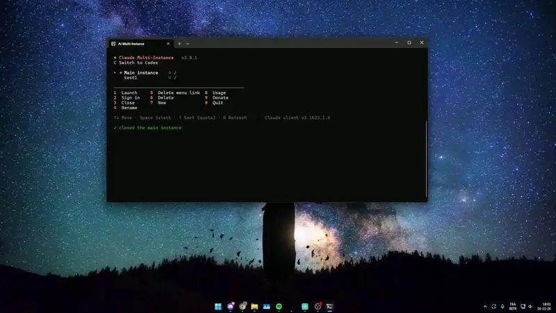

<h1 align="center">AI Multi-Instance</h1>

<p align="center">
  Manage multiple Claude and Codex desktop accounts on Windows.<br>
  Open separate profiles, or switch Codex accounts while keeping your local chats.
</p>

<p align="center">
  <a href="https://github.com/Zoltak-Dev/ai-multi-instance/archive/refs/heads/main.zip"></a>
  <a href="https://github.com/Zoltak-Dev/ai-multi-instance/releases"></a>
  <a href="https://ko-fi.com/zoltrak"></a>
</p>

<p align="center">
  <a href="docs/demo.mp4"></a><br>
  <a href="docs/demo.mp4">▶ Watch the 1-minute demo</a>
</p>

## Install

**Windows 10 or 11** with at least one supported desktop app installed as a Windows app package. [Claude Desktop](https://claude.ai/download) · [ChatGPT desktop app with Codex](https://chatgpt.com/download/)

**From source — recommended**

Install Python 3.9+ and Git, then run these commands in a terminal. No extra Python packages are needed. [Python](https://www.python.org/downloads/windows/) · [Git](https://git-scm.com/install/windows)

```powershell
git clone https://github.com/Zoltak-Dev/ai-multi-instance.git
cd ai-multi-instance
python main.py
```

You can also extract the source ZIP and run `python main.py` from its folder. Git is needed for automatic updates of a cloned installation.

## Use

1. Run `python main.py`. Use `C` to switch between Claude and Codex.
2. Press `7` and name your profile. Follow the sign-in prompt or press `2` later. The tool also tries to create a desktop shortcut for the profile.
3. Select it with `↑` / `↓`, then press **`Enter` or `1`** to open it.

**Main instance** is your regular Claude or Codex window. The rows below it are your saved profiles. A filled dot `●` marks a running instance. Use `Space` to select several profiles for actions such as closing them or managing their shortcuts.

### Sign in to a profile

Highlight a named profile and press `2` to sign in or change its account.

- **Claude.** The tool closes your main Claude window, sets its data aside, and opens a blank Claude for sign-in. When the new session is ready, the tool saves it to your profile and restores your main data. Press `Q` or `Esc` in the manager to cancel. If the manager closes during sign-in, reopen it and choose `R` when it offers to restore the main session.
- **Codex.** Pick your ChatGPT account in the browser. The tool uses the CLI bundled with Codex Desktop and saves the login to the selected profile once sign-in succeeds. Your main Codex session and chats stay in place. Press `Q` or `Esc` in the manager to cancel.

When you sign in to an existing profile, a successful Claude sign-in replaces that profile's saved app data. A successful Codex sign-in replaces its saved login.

### Choose how Codex opens profiles

Use `H` to switch modes.

| Mode | What happens when you open a profile |
| --- | --- |
| **Shared history** (default) | The account opens in Main instance and uses its local chat history. Recommended if you switch accounts to keep working on the same chats. |
| **Isolated profiles** | The account opens in its own window with separate app data and local history. You can keep several accounts open side by side. |

In Shared history, the loaded profile appears next to **Main instance**. If a switch would close the current window, the tool asks you to press `Enter` or `1` again. With Main instance closed, use `D` to attach or detach a saved account. Changing to Isolated profiles detaches the loaded profile and keeps it available in the list. When you first replace a main account that has no saved profile, the tool saves it as **Original main account**.

Claude always opens named profiles in separate windows. The tool launches the installed clients with a separate data directory for each isolated profile. Those directories live next to the tool under `ClaudeProfiles/` and `CodexProfiles/` and include saved sign-ins.

### Check usage

The menu shows the last known **remaining** quota for the `5h` and `7d` windows when available, then refreshes it in the background. A green `✓` means the last usage check succeeded. A grey `✓` means the tool couldn't verify the account.

Press `8` to fetch current quotas for the selected app. Each account shows its own reset times and the limits reported by its plan. Claude may also report limits per model. A Codex profile loaded in Main instance appears there once.

```text
Main instance · Work
5h         72% left   resets in 43m
7d         38% left   resets in 2d 6h
```

Press `R` inside Usage to fetch again. If a request fails, the screen shows the reason. The tool uses the accounts already signed in to Claude or Codex to check their quotas.

### Keyboard controls

| Key | Action |
| --- | --- |
| `↑` / `↓` | Choose a profile |
| `Enter` / `1` | Launch or switch to it |
| `2` | Sign in |
| `3` | Close the selected instance |
| `4` | Rename a profile |
| `5` | Create or delete a desktop shortcut |
| `6` | Delete a profile |
| `7` | Create a profile |
| `8` | Fetch current usage and reset times |
| `9` | Donate |
| `0` | Quit the manager |
| `C` | Switch between Claude and Codex |
| `Space` | Select several profiles |
| `T` | Sort by name or remaining quota in the menu or Usage. The choice is saved. |
| `R` | Refresh the selected account, or all accounts in Usage |
| `H` / `D` | Change Codex mode / attach or detach a profile in Shared history |

## Tips

- **Desktop shortcuts.** On Main instance, `5` creates or deletes a shortcut to this menu. On a profile, it creates or deletes a shortcut that opens that profile directly.
- **Use another browser profile if sign-in gets stuck.** If ChatGPT stops letting you add accounts in one Chrome profile, open the sign-in link in another profile or create one. [Chrome profiles](https://support.google.com/chrome/answer/2364824?hl=en)

## Updates

The tool checks GitHub at startup and offers a source update when the program files have changed. Edits to the README, changelog or tests do not trigger a notice. If you cloned the official repo and have a clean working tree on `main`, choose **Update** when offered, then reopen the tool. You can also close the manager and run `git pull --ff-only` in its folder.

For a source ZIP installation, download the new source ZIP and replace the program files in the same folder. **Keep `ClaudeProfiles/`, `CodexProfiles/` and `data/`** to preserve your sign-ins, profiles and settings. Desktop shortcuts point to the folder where you created them.

## Troubleshooting

- **The manager can't find Claude or Codex.** Open the desktop app from the Windows Start menu, then restart AI Multi-Instance. If the app is missing from Start, use the official download links above.
- **Usage shows an error.** Press `R` in Usage to retry. If the account is signed out, go back to the menu and press `2` on the profile. For Main instance, sign in directly in Claude or Codex.
- **Claude sign-in gets stuck.** Press `Q` or `Esc` in the manager to cancel. Then select the profile and press `2` to try again.
- **Cowork won't open in a separate Claude profile.** Try opening Cowork in Main instance. [Cowork issue](https://github.com/Zoltak-Dev/ai-multi-instance/issues/5)

<details>
<summary>Diagnostics and tests</summary>

Run this from the project folder to see which Claude data folders the manager detects.

```powershell
python -m tools.diagnose_login --duration 0
```

Run the automated tests from the same folder. They simulate app launches and use temporary profiles.

```powershell
python -m unittest discover -v
```

</details>

## Star History

<a href="https://www.star-history.com/?repos=Zoltak-Dev%2Fai-multi-instance&type=date&legend=top-left">
 <picture>
   <source media="(prefers-color-scheme: dark)" srcset="https://api.star-history.com/chart?repos=Zoltak-Dev/ai-multi-instance&type=date&theme=dark&legend=top-left&sealed_token=AjPPiTEoI91pJvO3tq8VAVB4p8-33d7TyehYw_w6qztZhQkLnrnldsW_nR3I4zzVNgkRMm2NFa-7y-V4Pp6cBeSbaD0APavs6bbwwwZvA1K903na1cRLVtNI4LAtk4K58SWyy4lL9aq3SdoKJ0EUphIMsXaoL1Ng4kT3GmcYSJMQQnXZphtTThJeT0ys" />
   <source media="(prefers-color-scheme: light)" srcset="https://api.star-history.com/chart?repos=Zoltak-Dev/ai-multi-instance&type=date&legend=top-left&sealed_token=AjPPiTEoI91pJvO3tq8VAVB4p8-33d7TyehYw_w6qztZhQkLnrnldsW_nR3I4zzVNgkRMm2NFa-7y-V4Pp6cBeSbaD0APavs6bbwwwZvA1K903na1cRLVtNI4LAtk4K58SWyy4lL9aq3SdoKJ0EUphIMsXaoL1Ng4kT3GmcYSJMQQnXZphtTThJeT0ys" />
   
 </picture>
</a>

[Changelog](CHANGELOG.md) · [Code signing policy](.github/signpath/CODE_SIGNING.md) · [Report an issue](https://github.com/Zoltak-Dev/ai-multi-instance/issues) · [MIT License](LICENSE)
